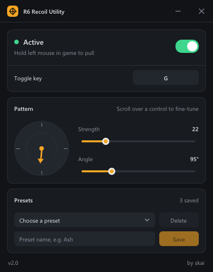

# R6 Recoil Utility

A small, simple recoil-control utility for Rainbow Six Siege. Written in C++ with Dear ImGui (DirectX 9).

<p align="center"></p>

## Features

- **Strength + angle**, with a live direction dial you can drag (90° = straight down)
- **Toggle hotkey** — `G` by default, rebind to any key or mouse side button
- **Presets** — save, load and delete per-operator setups
- **Smooth, accurate pull** — runs on its own 1 ms thread with sub-pixel precision
- **Lightweight** — one small exe, no installer or VC++ redistributable, ~0% CPU when idle

## Usage

1. Run `R6RecoilUtility.exe`.
2. Set **Strength** and **Angle** (or pick a preset).
3. Flip the switch or press your toggle key.
4. Hold left mouse in game — it pulls while you fire.

Tips:

- Scroll over the dial or a slider to nudge it by 1; hold Shift while dragging the dial to snap to 5°.
- It never pulls while the utility window itself is focused, so you can adjust settings safely.
- Settings and presets are stored in `R6RecoilUtility.ini` next to the exe.

## Building

Requires Visual Studio 2022 (or Build Tools) with the **Desktop development with C++** workload.

Open `R6RecoilUtility.sln` and build **Release | x64**, or from a Developer Command Prompt:

```
msbuild R6RecoilUtility.sln -p:Configuration=Release -p:Platform=x64
```

The exe is written to `bin\Release\`.

## Project layout

| Path | What it does |
| --- | --- |
| `src/recoil.*` | Recoil engine thread (hotkey, timing, mouse movement) |
| `src/ui.*` | Theme, widgets and the main window layout |
| `src/platform.*` | Borderless Win32 window, D3D9 device, ImGui backends |
| `src/config.*` | Loading/saving settings and presets |
| `imgui/` | [Dear ImGui](https://github.com/ocornut/imgui) 1.86 |

## Disclaimer

Use at your own risk. Third-party input tools may be against the game's terms of service.

## Credits

- [Dear ImGui](https://github.com/ocornut/imgui) by Omar Cornut
- Original borderless window template by [cazzwastaken](https://github.com/cazzwastaken/borderless-imgui-window)
